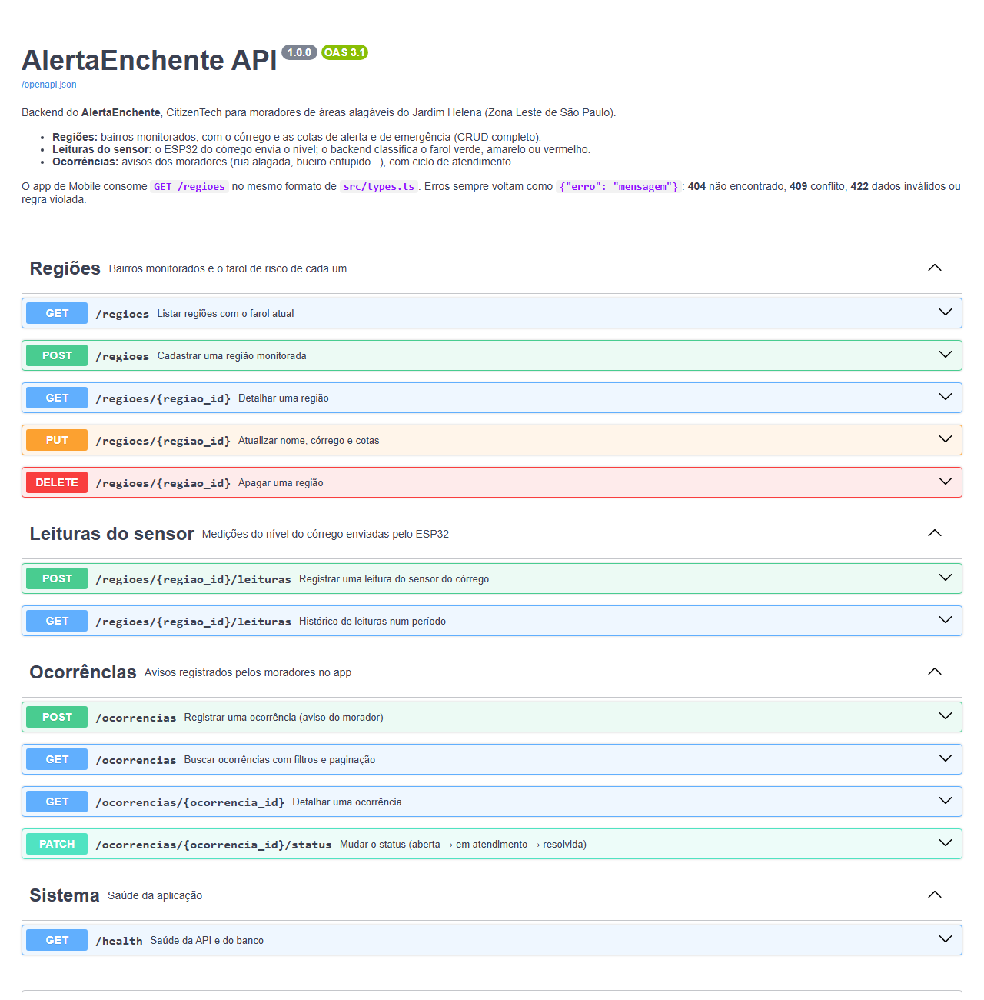
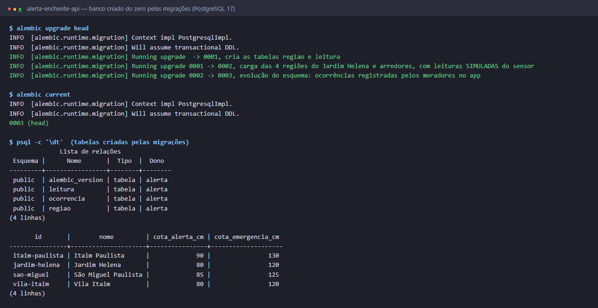
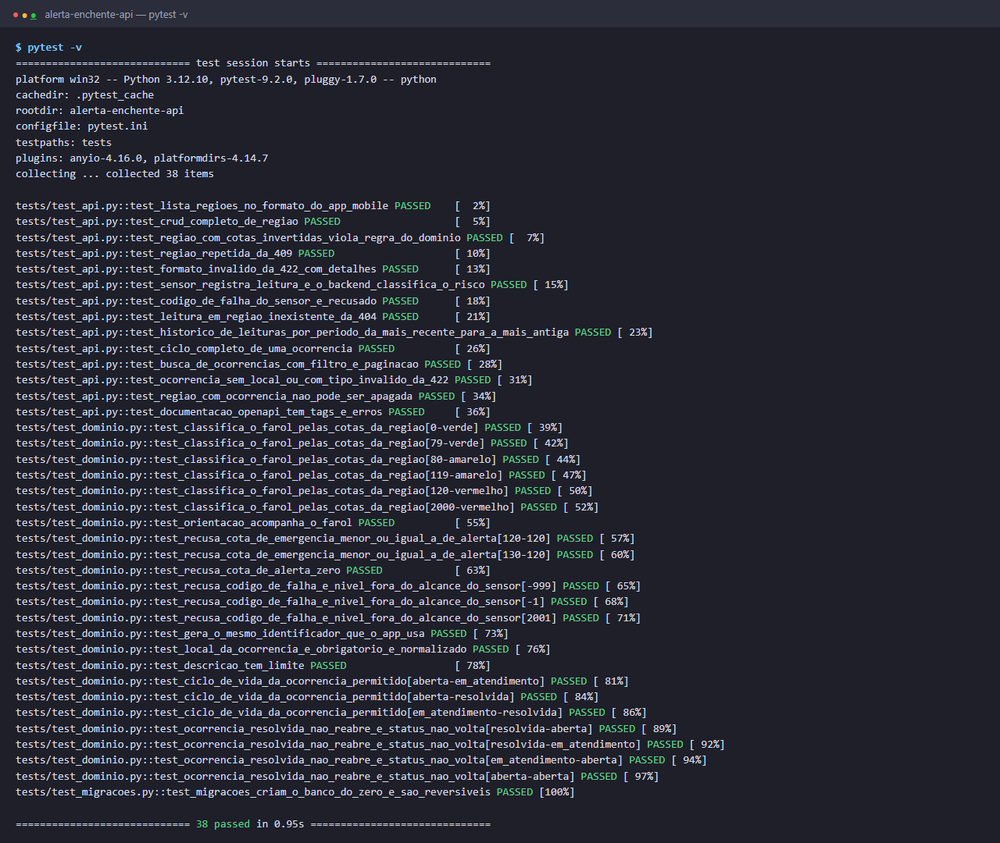
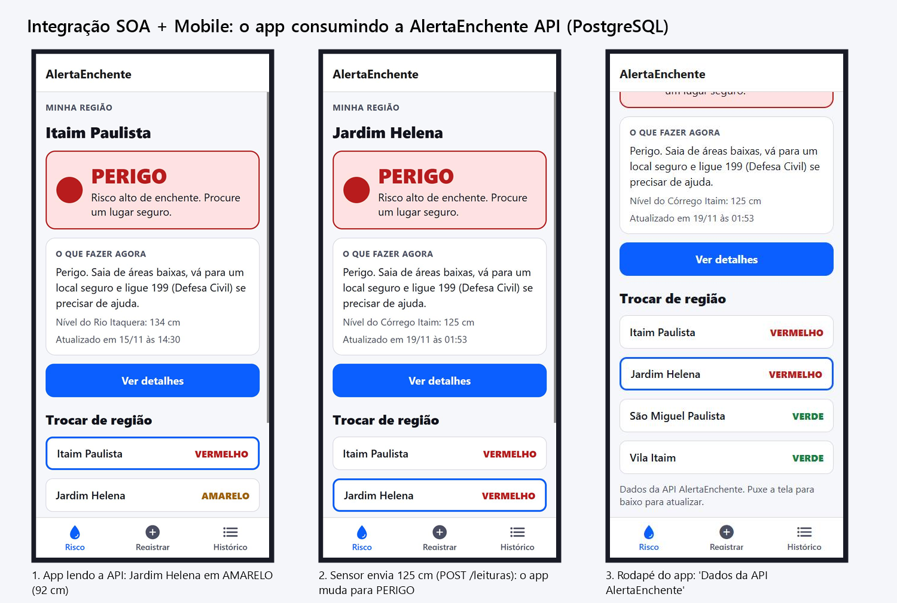
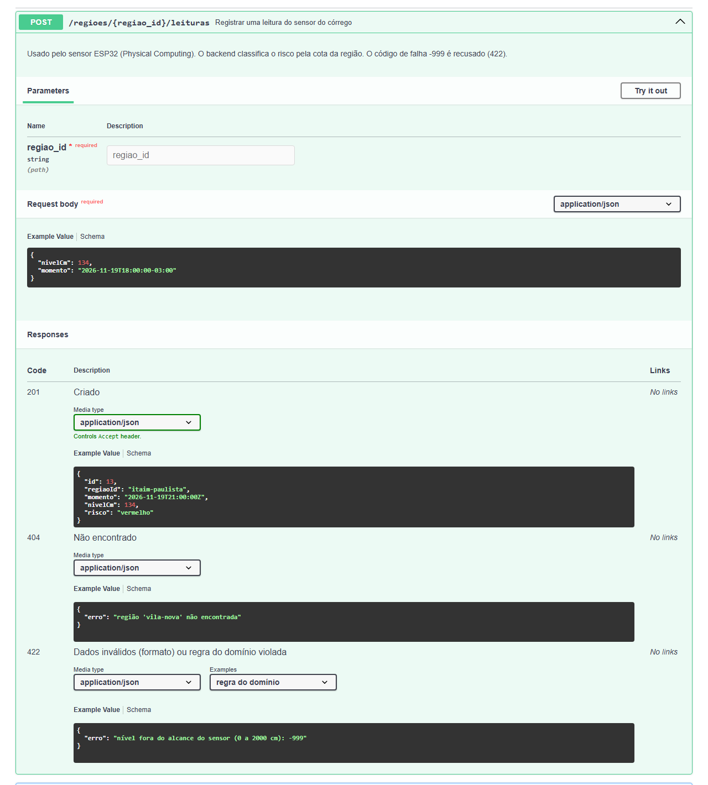

# AlertaEnchente API · o backend da CitizenTech

Entrega de **Arquitetura Orientada a Serviços (SOA) e Web Services** · FIAP · Engenharia de Software (3º ano) · Global Solution 2026.2

API REST em **Python (FastAPI)**, com **PostgreSQL**, migrações **Alembic**, documentação automática **OpenAPI/Swagger** e testes automatizados com **pytest**. Ela guarda os dados e as regras do AlertaEnchente; o app de Mobile e o sensor do córrego conversam com ela.

## Ficha da CitizenTech

| Campo | Preenchimento |
|---|---|
| Nome da CitizenTech | AlertaEnchente |
| Cidade e bairro | São Paulo, Jardim Helena (Zona Leste) |
| Cidadão beneficiado | Moradores e pequenos comerciantes de áreas alagáveis |
| Problema, em uma frase | Moradores de áreas alagáveis recebem os avisos de enchente tarde demais para proteger pessoas e bens. |
| Como funciona | Um sensor mede o nível do córrego e envia para esta API, que classifica o risco (verde, amarelo ou vermelho) pelas cotas de cada região. O app mostra o farol e o que fazer, e o morador registra problemas (rua alagada, bueiro entupido) que a prefeitura acompanha. |
| O que cada parte faz | **SOA (este repositório):** dados, regras e contrato REST. **Mobile:** app do morador, que consome `GET /regioes`. **Physical Computing:** sensor ESP32, que envia `POST /regioes/{id}/leituras`. **Operating Systems:** VM Linux que hospeda o serviço. **Cybersecurity:** proteção de dados pessoais. **IA/ML:** previsão de chuva intensa. |
| Link do repositório | https://github.com/duduescudero/alerta-enchente-api |
| Indicador de impacto | Tempo entre a leitura do sensor e o farol no app; ocorrências resolvidas por região |
| ODS conectados | ODS 9, ODS 11 e ODS 13 |

## Integrantes

| Nome | RM |
|---|---|
| Arthur Silva | RM553320 |
| Eduardo Escudero | RM556527 |
| Leonardo Prado | RM556824 |
| Davi Vieira | RM556798 |
| Luca Monteiro | RM556906 |

## Arquitetura

```
 App Mobile (Expo)      Sensor ESP32 do córrego
        │ GET /regioes          │ POST /regioes/{id}/leituras
        └──────────────┬────────┘
                       ▼
   api/            HTTP: rotas, DTOs (camelCase), status e erros      ← app/api
   aplicacao/      casos de uso e transação                            ← app/aplicacao
   dominio/        entidades e REGRAS (não conhece HTTP nem banco)     ← app/dominio
   infraestrutura/ repositórios e modelos SQLAlchemy                   ← app/infraestrutura
                       ▼
             PostgreSQL 17  (esquema criado pelas migrações Alembic)
```

### Domínio: entidades e regras

| Entidade | O que é | Regras (em `app/dominio/`, testadas sem banco e sem HTTP) |
|---|---|---|
| **Região** | Bairro monitorado, com o córrego e as cotas | A cota de emergência precisa ser maior que a de alerta. O farol é verde abaixo do alerta, amarelo até a emergência e vermelho daí para cima (mesma regra do app). Cada cor tem uma orientação ao morador. O id é gerado do nome ("São Miguel Paulista" → `sao-miguel-paulista`) |
| **Leitura** | Nível do córrego medido pelo sensor (1 região → N leituras) | O nível vai de 0 a 2000 cm. O **-999** é o código de falha do transmissor e é recusado. O risco é calculado pelo domínio no momento da leitura |
| **Ocorrência** | Aviso do morador (1 região → N ocorrências) | O local é obrigatório. Os tipos são fixos. O ciclo é **aberta → em atendimento → resolvida**; uma ocorrência resolvida não reabre |

Uma regra da aplicação: **uma região com ocorrências de moradores não pode ser apagada (409)**, para não perder o histórico.

## Endpoints

Documentação interativa: **http://localhost:8000/docs** (Swagger UI) · contrato: **http://localhost:8000/openapi.json**

| Método e caminho | O que faz | Respostas |
|---|---|---|
| `GET /regioes` | Lista as regiões com o farol atual (é o que o app consome) | 200 |
| `GET /regioes/{id}` | Detalha uma região | 200, 404 |
| `POST /regioes` | Cadastra uma região | 201, 409, 422 |
| `PUT /regioes/{id}` | Atualiza nome, córrego e cotas | 200, 404, 422 |
| `DELETE /regioes/{id}` | Apaga a região e as leituras dela | 204, 404, 409 |
| `POST /regioes/{id}/leituras` | O sensor envia o nível; o backend classifica o risco | 201, 404, 422 |
| `GET /regioes/{id}/leituras?de=&ate=&limite=` | Histórico **por período**, do mais recente para o mais antigo | 200, 404, 422 |
| `POST /ocorrencias` | Morador registra um problema | 201, 404, 422 |
| `GET /ocorrencias?regiaoId=&status=&pagina=&tamanho=` | Busca **com filtros e paginação** | 200, 422 |
| `GET /ocorrencias/{id}` | Detalha uma ocorrência | 200, 404 |
| `PATCH /ocorrencias/{id}/status` | Avança o atendimento | 200, 404, 422 |
| `GET /health` | Saúde da API e do banco | 200 |

Os erros sempre voltam como `{"erro": "mensagem"}`. Erros de formato trazem também `"detalhes"` com o campo e o problema.



## Como rodar

Pré-requisitos: **Python 3.11 ou superior** e **Docker** (ou um PostgreSQL instalado).

```bash
git clone https://github.com/duduescudero/alerta-enchente-api.git
cd alerta-enchente-api

cp .env.example .env              # Windows: copy .env.example .env   → troque a senha nos dois lugares
docker compose up -d              # sobe o PostgreSQL 17 com usuário, senha e banco do .env

python -m venv .venv
source .venv/bin/activate         # Windows: .venv\Scripts\activate
pip install -r requirements.txt

alembic upgrade head              # cria o banco do zero: tabelas + regiões simuladas + ocorrências
uvicorn main:app --reload         # API em http://localhost:8000  ·  documentação em /docs
```

**Sem Docker:** crie no seu PostgreSQL o usuário e o banco do `.env` e ajuste a `DATABASE_URL`. O resto é igual.

**Recriar o banco do zero:** `docker compose down -v && docker compose up -d && alembic upgrade head`

### Migrações (Alembic)

| Versão | O que faz |
|---|---|
| `0001_cria_regiao_e_leitura` | Cria `regiao` e `leitura`, com chave estrangeira, *check* de cotas e de nível, e um índice por região e momento |
| `0002_carga_regioes_simuladas` | Carrega as 4 regiões do app (Jardim Helena, Vila Itaim, Itaim Paulista e São Miguel Paulista) com leituras **simuladas** |
| `0003_cria_ocorrencia` | Evolução do esquema: tabela `ocorrencia` (chave estrangeira para região, *check* de tipo e status, índice) |

O esquema **não** é criado pelo ORM ao subir a aplicação: vem só das migrações. Todas têm `downgrade`.



## Testes automatizados

```bash
pytest -v
```

São **38 testes**:

- **Unidade do domínio (23):** farol pelas cotas, cotas invertidas, -999, identificador, local e ciclo da ocorrência. Rodam sem banco e sem HTTP.
- **API (14):** status e corpo de cada endpoint, incluindo CRUD, 404, 409, 422, período e paginação.
- **Migrações (1):** cria um PostgreSQL do zero, confere tabelas, chaves estrangeiras e a carga contra a regra do domínio, desfaz tudo e sobe de novo.

Os testes de API usam um SQLite em memória descartável (como o guia permite). O de migrações roda contra PostgreSQL quando `DATABASE_URL_TESTE` aponta para um banco **descartável**, porque ele apaga o banco a cada execução; sem a variável, o teste é pulado.



## Integração com as outras partes da CitizenTech

**App de Mobile:** no repositório [alerta-enchente-mobile](https://github.com/duduescudero/alerta-enchente-mobile), crie um `.env` com `EXPO_PUBLIC_API_URL=http://<IP-do-computador>:8000`. O app passa a ler `GET /regioes` desta API, no mesmo formato de `src/types.ts`.

Na evidência abaixo, o "sensor" envia 125 cm para o Jardim Helena e o app muda de ATENÇÃO para **PERIGO**:



**Sensor ESP32 (Physical Computing):** a cada medição, o sensor envia:

```bash
curl -X POST http://localhost:8000/regioes/jardim-helena/leituras \
     -H "Content-Type: application/json" -d '{"nivelCm": 125}'
# 201 {"id":17,"regiaoId":"jardim-helena","momento":"...","nivelCm":125,"risco":"vermelho"}
```



## De onde vêm os dados

- **Regiões e cotas:** as mesmas do app de Mobile. Os bairros são reais; as cotas são simuladas para a demonstração.
- **Leituras da migração 0002:** **simuladas**, não são medições reais do córrego.
- **Nenhum dado pessoal:** a ocorrência guarda só o tipo, o local (rua ou ponto de referência) e a descrição.

## Estrutura

```
app/
  dominio/          regiao.py, ocorrencia.py, erros.py      ← regras (sem framework)
  aplicacao/        casos_de_uso.py, erros.py               ← casos de uso e transação
  infraestrutura/   db.py, modelos.py, repositorios.py      ← banco
  api/              rotas.py, esquemas.py, erros.py         ← HTTP
migrations/         env.py, versions/0001..0003             ← Alembic
tests/              test_dominio.py, test_api.py, test_migracoes.py
main.py · alembic.ini · docker-compose.yml · requirements.txt · .env.example
docs/evidencias/    prints da documentação, migrações, testes e integração
```

## Uso de IA

O registro de como a equipe usou IA está em [`prompts.md`](prompts.md).
